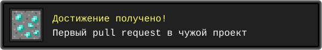
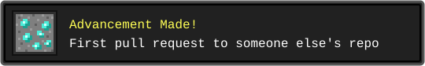

  

### `> about`

**`RU`** Играю в CTF и разбираюсь в безопасности: ломаю, чтобы понять, как оно устроено. Сюда выкладываю то, что получилось интересного.

**`EN`** I play CTFs and dig into security: I break things to see how they work. This is where the interesting stuff ends up.

### `> inventory`

| | Проект / Project | Что это / What it is |
|:-:|---|---|
| 📝 | [**humanizer**](https://github.com/SenseiAleksei/humanizer) | Скилл для Claude, который убирает признаки ИИ из текста. Я добавил поддержку русского: канцелярит, кальки, правильные тире. Claude skill that strips AI tells from text. I added Russian support. |

### `> advancements`

 

